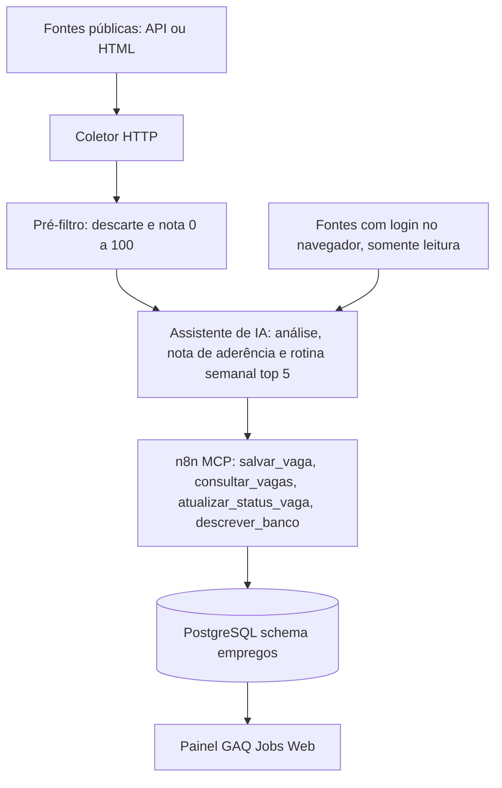

# GAQ Jobs Web

Painel privado de vagas e candidaturas da GAQ CLOUD, no ar em [https://jobs.gaqtech.dev](https://jobs.gaqtech.dev).

Situação: **em produção**.

Stack: React + TypeScript + Vite, FastAPI, PostgreSQL 18 (schema `empregos`) e Docker Compose (Coolify). O assistente de IA grava e consulta o mesmo banco por meio do n8n/MCP, com as ferramentas `salvar_vaga`, `consultar_vagas`, `atualizar_status_vaga` e `descrever_banco`. Cada vaga tem três famílias de status auditáveis: `NOTIFICACAO`, `CANDIDATURA` e `DISPONIBILIDADE`.

O fluxo antigo chamado **Pipeline de Análise de Vagas com IA** (WhatsApp e Google Sheets) e qualquer menção a Whisper ou Telegram são um sistema separado, legado. Não fazem parte deste painel, do coletor nem do pré-filtro.

## Pipeline

As vagas entram por dois caminhos somente leitura. O coletor HTTP baixa fontes públicas (sem login). O assistente, no navegador e já autenticado, lê LinkedIn (posts de recrutadores, não a aba de empregos), Padrinho e Robô de Vagas. A lista completa está em [docs/FONTES.md](docs/FONTES.md).



O pré-filtro corta o que claramente não serve (nível, idioma obrigatório, horário, local presencial, piso salarial) e deixa uma nota folgada. O assistente faz a leitura fina, grava `aderencia` e `score_prefiltro` via MCP e, na rotina semanal, escolhe as cinco melhores. O painel só lê e atualiza o que já está no banco.

## Funcionalidades

- Login próprio com Argon2id, sessões por cookies protegidos, validação de origem e CSRF.
- Sidebar recolhível, filtros de modalidade, contrato, aderência e data de coleta, busca e paginação.
- Detalhes, link original da vaga, status de candidatura e observações pessoais.
- Histórico auditável já existente em `empregos.vagas_status_hist`.
- Implantação sem adicionar outro banco PostgreSQL à Oracle.

## Arquivos

- `compose.yaml`: produção atual da GAQ; apenas web e API (**não foi modificado**).
- `compose.managed.yaml`: site + API + migração/verificação condicional usando PostgreSQL existente.
- `compose.standalone.yaml`: PostgreSQL 18 persistente + migrador condicional + site e API.
- `compose.db-bootstrap.yml`: inicialização SQL opcional contra um banco PostgreSQL existente.
- `compose.db-local.yml`: PostgreSQL isolado para laboratório.
- `db/`: instaladores de tabelas, migração v2 e autenticação local.
- `n8n/GAQ_Jobs_MCP_importar.json`: workflow importável com 4 ferramentas, sem senhas.
- `coletor/`: coleta HTTP sem login. Config de exemplo em `config.example.json`; `GITHUB_TOKEN` opcional em `coletor/.env.example`.
- `prefiltro/`: descarte e nota antes do assistente. Filtros eliminatórios editáveis no config de exemplo.
- `docs/INSTALACAO.md`: instruções completas para Coolify e PostgreSQL.
- `docs/BANCO_DE_DADOS.md`: dicionário técnico das cinco tabelas, chaves, regras, permissões, funções MCP e auditoria.
- `docs/DIAGRAMA_ER.md`: diagrama Mermaid dos relacionamentos e arquitetura de acesso ao PostgreSQL.
- `docs/USO.md`: guia do painel.
- `docs/N8N_MCP.md`: guia para conectar o assistente.
- `docs/FONTES.md`: de onde vêm as vagas.

## Instalação na Oracle

Como o banco gaq e as tabelas `empregos.vagas` e `empregos.vagas_status_hist` já existem, faça backup e execute somente `db/001_auth_whodb.sql` no WhoDB. Defina uma senha exclusiva para `gaq_jobs_web`, configure `DATABASE_URL`, `APP_ORIGIN` e `SESSION_SECRET` no Coolify, publique a aplicação a partir de `compose.yaml` na branch `main` e crie o primeiro administrador pelo terminal da API.

Não crie outro banco nem execute full bootstrap no PostgreSQL de produção sem backup e avaliação.

## Busca de vagas, no seu computador

Python 3.11 ou superior (os testes de CI usam 3.13). Coletor e pré-filtro usam só a biblioteca padrão.

```bash
cd coletor
cp config.example.json config.json
cp .env.example .env
python3 coletor.py
python3 testes.py

cd ../prefiltro
cp config.example.json config.json
python3 prefiltro.py ../coletor/vagas_coletadas.json -o /tmp/vagas_prefiltradas.json
python3 testes.py
```

`config.json`, `coletor/.env` e os arquivos `vagas_*.json` não entram no Git. Os filtros de idioma, horário e local presencial aceitam vazio ou `null` para desligar. Exemplos em [prefiltro/README.md](prefiltro/README.md).
