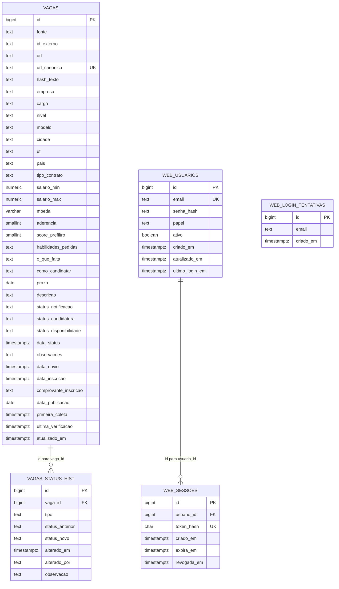
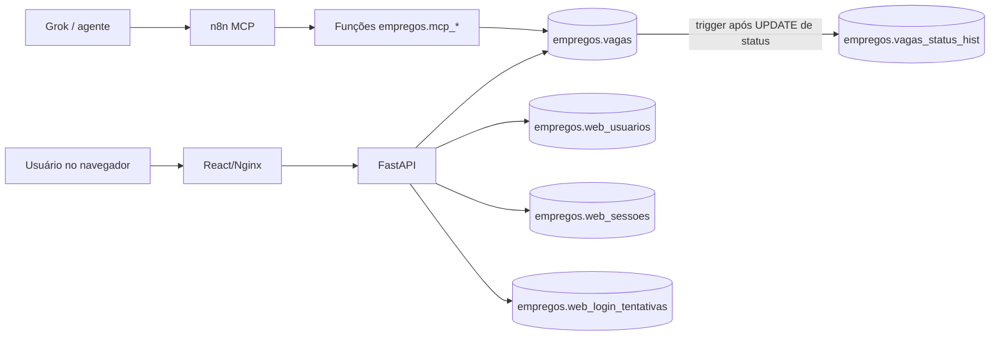

# Diagrama entidade-relacionamento (ER) — GAQ Jobs

Modelo lógico das **cinco tabelas reais** do schema `empregos`, conforme os instaladores SQL atuais.

## Diagrama

**Como interpretar:**

- `VAGAS (1) → VAGAS_STATUS_HIST (0..N)`: uma vaga tem zero ou muitos eventos de status. FK `vaga_id` com `ON DELETE CASCADE`.
- `WEB_USUARIOS (1) → WEB_SESSOES (0..N)`: uma conta tem zero ou muitas sessões. FK `usuario_id` com `ON DELETE CASCADE`.
- `WEB_LOGIN_TENTATIVAS` não possui FK para `WEB_USUARIOS`. O campo `email` é apenas texto para registrar tentativas, inclusive de contas inexistentes.
- Também **não há FK** entre contas web e vagas ou histórico. O autor da mudança fica como texto em `vagas_status_hist.alterado_por`.
- `UK` é a unicidade. O `email` web é único via índice `lower(email)`; `url_canonica` tem UNIQUE. Existe ainda um índice único **parcial** em `vagas(fonte,id_externo)` quando `id_externo` não é nulo; índices parciais não são expressos pelo diagrama ER.

## Diagrama funcional (sem implicar chaves estrangeiras)

## Restrições e ressalvas

Os diagramas não substituem `CHECK`, `UNIQUE`, `NOT NULL`, triggers nem permissões. O SQL define:

- Três famílias independentes de status: `NOTIFICACAO`, `CANDIDATURA`, `DISPONIBILIDADE`.
- Auditoria por trigger depois da migração `020_status_v2_whodb.sql`.
- Controle de login via `web_usuarios`, sessão com hash em `web_sessoes` e proteção contra repetição de tentativas em `web_login_tentativas`.
- Campos financeiros e de aderência sujeitos a validações; diferentes colunas podem ser opcionais.

Para os tipos, regras, funções e limitações completas, consulte [BANCO_DE_DADOS.md](BANCO_DE_DADOS.md). Os scripts SQL [000](../db/000_jobs_whodb.sql), [020](../db/020_status_v2_whodb.sql), [030](../db/030_comprovante_inscrito_whodb.sql) e [001](../db/001_auth_whodb.sql) são as fontes de implementação.

> O Mermaid é renderizado diretamente pelo GitHub; não é necessário manter imagens estáticas.
